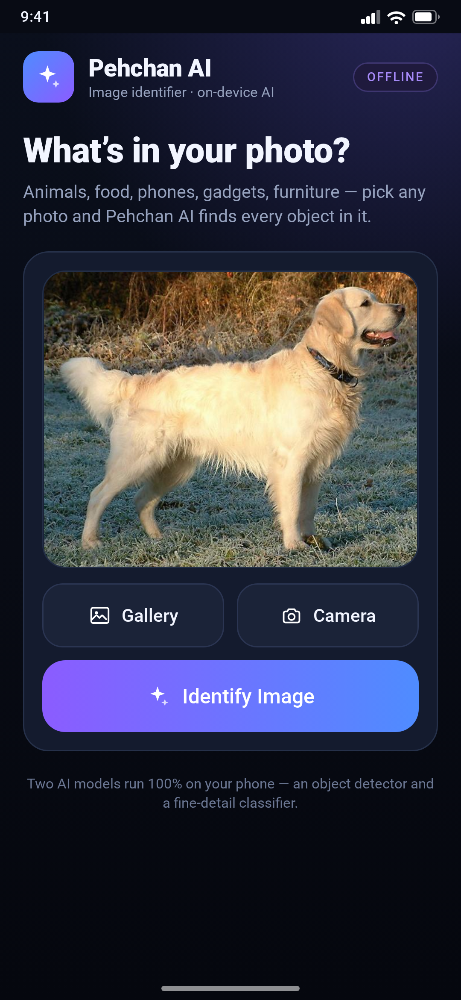
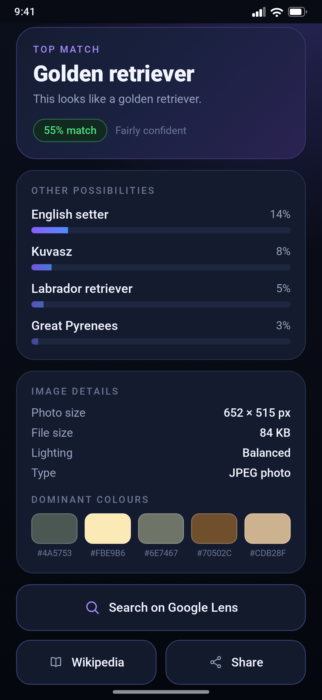
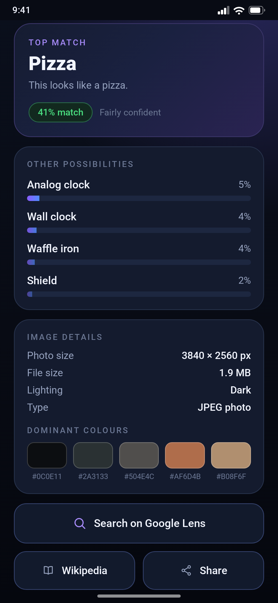

# Pehchan AI — Offline Image Identifier for Android

Point your phone at anything, tap one button, and find out what it is. Pehchan AI runs a
quantised **EfficientNet-Lite0** model **entirely on the device** — no internet, no account,
no upload, no ads. Your photos never leave your phone.

| Home | Photo picked | Result | Another example |
|:--:|:--:|:--:|:--:|
|  |  |  |  |

> The images above are UI previews rendered from the app's own layout (same dp values,
> colours and fonts) at 1080×2340 px, because the build machine had no Android emulator.
> The values shown are real — produced by running the bundled model on those two photos.

---

## Download & install

**[⬇ Download PehchanAI-v1.0.apk (11 MB)](https://github.com/technicalnihilist-lgtm/pehchan-ai/releases/download/v1.0/PehchanAI-v1.0.apk)**

1. Tap the link on your phone (or open the [v1.0 release](https://github.com/technicalnihilist-lgtm/pehchan-ai/releases/tag/v1.0) page).
2. Android asks to allow installs from this source → allow.
3. Install, open, done. Works on **Android 5.0 (API 21) and newer**, any phone.

```
SHA-256  a476884ddece158ebc79ab5a8e0714083e7a29908bc3008bf5201f1a72610069
```

The APK is signed with v1 + v2 + v3 schemes, so it installs cleanly on modern Android.

## What it does

* **Identify a photo** — gallery or camera, then one tap. Top match plus the next four
  possibilities with confidence bars.
* **Plain-language answer** — "This looks like a golden retriever." + `55% match` + a
  confidence word (High / Fairly confident / Best guess) so the number means something.
* **Image details** — real photo size, file size, lighting (Bright / Balanced / Dark) and the
  five **dominant colours** with hex codes.
* **Search on Google Lens** — one tap for anything the on-device model doesn't know.
* **Wikipedia** — opens the article for the top match.
* **Share** — sends the photo + the result text to any app.
* **Open-with support** — share an image *to* Pehchan AI from your gallery or any other app.

## Why it feels fast and safe

| | |
|---|---|
| **100% offline** | The app declares **no internet permission at all** — it physically cannot upload your photos. |
| **No permissions** | No storage, camera or location permission. Photos are read through Android's own file picker; the camera hands back one photo. |
| **~11 MB** | Model + runtime are bundled; nothing is downloaded later. |
| **Works on any phone** | Native libraries for `arm64-v8a`, `armeabi-v7a`, `x86` and `x86_64`. |

## How it works

```
photo ──► decode (max 1600 px) ──► EXIF rotation fix ──► resize 224×224 RGB
      ──► EfficientNet-Lite0 int8 (TFLite) ──► dequantise 1000 ImageNet scores
      ──► top-5 with confidence ──► UI
```

* **Model** — `efficientnet_lite0_int8_2.tflite` (5.2 MB, fully-quantised uint8, 224×224 input,
  ImageNet-1k head). Runs on CPU with TFLite `Interpreter`, multi-threaded.
* **Labels** — the 1000 ImageNet class names, cleaned for display (`tabby, tabby cat` → `tabby cat`).
* **Colours / lighting** — computed on a 44 px thumbnail with the same algorithm shown in
  [`ImageInfo.java`](app/src/com/rajok/pehchanai/ImageInfo.java).
* **No support library, no Kotlin, no Compose** — plain Android framework classes, so the whole
  APK stays tiny and starts instantly.

### Honest limits

The on-device model knows the **1000 ImageNet categories** — the everyday objects it was trained
on: dogs and cats by breed, birds, fish, vehicles, food, fruit, furniture, tools, musical
instruments, clothing, sports gear and so on. For anything outside that list (a specific brand,
a rare plant, a monument, a person) the top match will be a low-confidence near-miss — that is
what the **Search on Google Lens** button is for. Nothing here pretends to recognise *every*
object in the universe; it recognises a lot of them, instantly and privately.

## Build it yourself

The project builds **without Gradle** — just the Android SDK build-tools, which keeps the build
easy to reproduce:

```bash
# needs: JDK 17, Android SDK build-tools 34 + platform android-35
export SDK=/path/to/android-sdk
bash app/build.sh          # → out/PehchanAI-v1.0.apk
```

`build.sh` runs the whole pipeline and prints each step:

```
fetch model (if missing) → aapt2 compile → aapt2 link → javac → d8
                         → package (dex + .so + assets) → zipalign → apksigner
```

It generates `app/keystore.jks` on first run if one is not present. **Keep that file** — Android
only accepts updates signed with the same key.

### Why the model is not in the tree

`app/assets/model.tflite` (5.2 MB) is attached to the [v1.0 release](https://github.com/technicalnihilist-lgtm/pehchan-ai/releases/tag/v1.0)
instead of being committed, because the GitHub API rejected the binary as too large. `build.sh`
downloads it automatically if it is missing, so a clean clone still builds with one command.
The labels file *is* in the tree (`app/assets/labels.txt`).

## Project layout

```
app/
├── AndroidManifest.xml              no permissions, portrait, share/VIEW filters
├── build.sh                         the whole build, 8 steps
├── assets/
│   ├── model.tflite                 EfficientNet-Lite0 int8 (fetched from the release)
│   └── labels.txt                   1000 ImageNet labels
├── res/
│   ├── layout/activity_main.xml     single screen, one scroll
│   ├── drawable/                    gradients, cards, 9 hand-written vector icons
│   ├── values/                      colours, strings, theme
│   └── mipmap-*/                    launcher icon (adaptive + PNG fallbacks)
└── src/com/rajok/pehchanai/
    ├── MainActivity.java            UI, picking, camera, results, sharing
    ├── Classifier.java              TFLite wrapper + top-5
    ├── ImageInfo.java               size / lighting / dominant colours
    └── FileShareProvider.java       tiny ContentProvider for camera + share
screenshots/                         UI previews (1080×2340)
```

## Credits

* Model: [EfficientNet-Lite0](https://github.com/tensorflow/tpu/tree/master/models/official/efficientnet/lite),
  converted and quantised by the TensorFlow team.
* Runtime: [TensorFlow Lite](https://www.tensorflow.org/lite) 2.14.0 (Apache-2.0).
* Labels: ImageNet class names (`ImageNetLabels.txt`).
* Everything else — UI, code, icons — written for this project.

## License

MIT — see [LICENSE](LICENSE).
