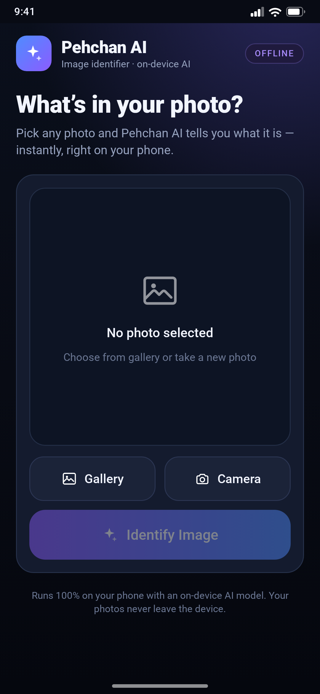
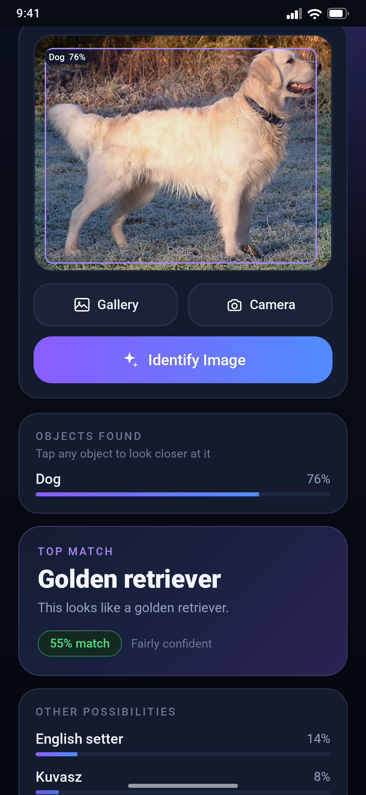
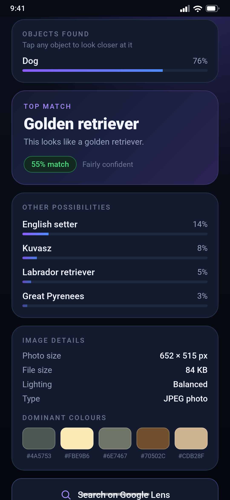
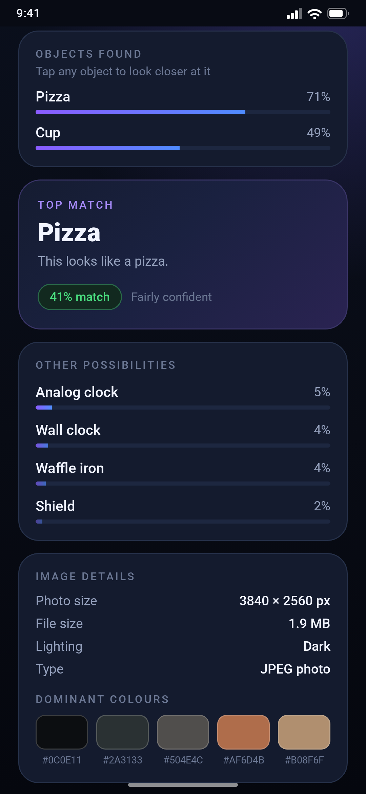

# Pehchan AI — Offline Image Identifier for Android

Point your phone at anything — a dog, a plate of food, a phone, a laptop, a chair — and
Pehchan AI finds every object in the photo, boxes it, and tells you what it is.
**Two AI models run entirely on the device**: no internet, no account, no upload, no ads.

| Home | Objects found | Result | Another example |
|:--:|:--:|:--:|:--:|
|  |  |  |  |

> These are UI previews rendered from the app's own layout (same dp values, colours and
> fonts) at 1080×2340 px, because the build machine had no Android emulator. The numbers in
> them are real — both models were run on those two photos to produce them.

---

## Download & install

**[⬇ Download PehchanAI-v1.6.apk (14 MB)](https://github.com/technicalnihilist-lgtm/pehchan-ai/releases/download/v1.6/PehchanAI-v1.6.apk)**

1. Tap the link on your phone (or open the [v1.6 release](https://github.com/technicalnihilist-lgtm/pehchan-ai/releases/tag/v1.6)).
2. Android asks to allow installs from this source → allow.
3. Install, open, done. **Android 5.0 (API 21) and newer**, any phone.

```
SHA-256  01cf5fbf298b3f0dcfb68aaf3765e739920c9718e6169346a815f66401037c48
```

Signed with v1 + v2 + v3 schemes, so it installs cleanly on modern Android.
Version 1.6 installs *over* v1.0–v1.5 (same signing key).

## What it does

* **Finds every object** — an on-device detector draws a box around each thing it sees and
  lists them with confidence: people, dogs, cats, birds, food, phones, laptops, TVs, chairs,
  tables, cars, bicycles, bottles, cups, and 60+ more categories.
* **Tap any object to look closer** — the app crops just that part of the photo and runs the
  fine-detail model on it, so "dog" becomes "golden retriever" and "car" becomes "sports car".
* **Plain-language answer** — "This looks like a golden retriever." + `55% match` + a
  confidence word (High / Fairly confident / Best guess), so the number means something.
* **Image details** — real photo size, file size, lighting (Bright / Balanced / Dark) and the
  five **dominant colours** with hex codes.
* **Search on Google Lens** — one tap for anything the on-device models don't know
  (brands, monuments, rare plants, specific products).
* **Wikipedia** — opens the article for the top match.
* **Share** — sends the photo plus the result text to any app.
* **Open-with support** — share an image *to* Pehchan AI from your gallery or any other app.

## Why it feels fast and safe

| | |
|---|---|
| **100% offline** | The app declares **no internet permission at all** — it physically cannot upload your photos. |
| **No permissions** | No storage, camera or location permission. Photos come through Android's own file picker; the camera hands back one photo. |
| **~14 MB** | Both models and the runtime are bundled; nothing is downloaded later. |
| **Works on any phone** | Native libraries for `arm64-v8a`, `armeabi-v7a`, `x86` and `x86_64`. |

## How it works

```
photo ──► decode (max 1600 px) ──► EXIF rotation fix
      ├─► 300×300  SSD-MobileNet detector ──► up to 10 boxes + labels  ──► drawn on the photo
      └─► 224×224  EfficientNet-Lite0      ──► 1000 ImageNet scores    ──► "best match"
                                          tap an object ──► crop ──► classify the crop
```

* **Detector** — SSD MobileNet V1, fully quantised, 300×300 uint8, COCO 80 classes, with
  non-max suppression built into the graph (`app/assets/detect.tflite`, 4.0 MB).
* **Classifier** — EfficientNet-Lite0 int8, 224×224 uint8, ImageNet-1k head
  (`app/assets/model.tflite`, 5.2 MB) — used for the whole photo *and* for the crop you tap.
* **Boxes** — drawn by `OverlayView`, which repeats the preview's centre-crop transform so the
  boxes stay glued to the right pixels at any photo shape.
* **Colours / lighting** — computed on a 44 px thumbnail in `ImageInfo.java`.
* **No support library, no Kotlin, no Compose** — plain Android framework classes, so the APK
  stays small and starts instantly.

### Honest limits

The detector knows the **80 COCO categories** — person, bicycle, car, motorcycle, airplane,
bus, train, truck, boat, traffic light, fire hydrant, stop sign, parking meter, bench, bird,
cat, dog, horse, sheep, cow, elephant, bear, zebra, giraffe, backpack, umbrella, handbag, tie,
suitcase, frisbee, skis, snowboard, sports ball, kite, baseball bat, baseball glove, skateboard,
surfboard, tennis racket, bottle, wine glass, cup, fork, knife, spoon, bowl, banana, apple,
sandwich, orange, broccoli, carrot, hot dog, pizza, donut, cake, chair, couch, potted plant,
bed, dining table, toilet, tv, laptop, mouse, remote, keyboard, cell phone, microwave, oven,
toaster, sink, refrigerator, book, clock, vase, scissors, teddy bear, hair drier, toothbrush.

The classifier adds **1000 fine-grained ImageNet classes** on top (dog breeds, bird species,
instruments, tools, and so on). Anything outside both lists — a specific brand, a monument, a
rare plant, a person's name — will come back as a low-confidence near-miss, which is exactly
what the **Search on Google Lens** button is for. No on-device model recognises *every*
object in the world; this one recognises a lot of them, instantly and privately.

## Build it yourself

No Gradle — just the Android SDK build-tools, which keeps the build easy to reproduce:

```bash
# needs: JDK 17, Android SDK build-tools 34 + platform android-35
export SDK=/path/to/android-sdk
bash app/build.sh          # → out/PehchanAI-v1.6.apk
```

`build.sh` runs the whole pipeline and prints each step:

```
fetch models (if missing) → aapt2 compile → aapt2 link → javac → d8
                          → package (dex + .so + assets) → zipalign → apksigner
```

It generates `app/keystore.jks` on first run if one is not present. **Keep that file** — Android
only accepts updates signed with the same key.

### Why the models are not in the tree

`app/assets/model.tflite` (5.2 MB) and `app/assets/detect.tflite` (4.0 MB) are attached to the
[v1.6 release](https://github.com/technicalnihilist-lgtm/pehchan-ai/releases/tag/v1.6) instead of
being committed, because the GitHub API rejects binaries that large in a normal commit.
`build.sh` downloads whichever one is missing, so a clean clone still builds with one command.
Both label files *are* in the tree.

## Project layout

```
app/
├── AndroidManifest.xml              no permissions, portrait, share/VIEW filters
├── build.sh                         the whole build, 8 steps
├── assets/
│   ├── detect.tflite                SSD-MobileNet detector, COCO 80 (fetched from the release)
│   ├── coco_labels.txt              the 80 object names
│   ├── model.tflite                 EfficientNet-Lite0 int8 (fetched from the release)
│   └── labels.txt                   1000 ImageNet labels
├── res/
│   ├── layout/activity_main.xml     single screen, one scroll
│   ├── drawable/                    gradients, cards, 9 hand-written vector icons
│   ├── values/                      colours, strings, theme
│   └── mipmap-*/                    launcher icon (adaptive + PNG fallbacks)
└── src/com/rajok/pehchanai/
    ├── MainActivity.java            UI, picking, camera, results, sharing
    ├── Detector.java                object detector + boxes
    ├── OverlayView.java             draws the boxes on the photo
    ├── Classifier.java              fine-detail classifier (whole photo + tapped crop)
    ├── ImageInfo.java               size / lighting / dominant colours
    └── FileShareProvider.java       tiny ContentProvider for camera + share
screenshots/                         UI previews (1080×2340)
```

## Changelog

**v1.6** — liquid-glass look. Every surface is now a translucent pane: cards and buttons use
a white 4–15% gradient fill with a 1 dp hairline border, the top-match card carries a violet
tint, pills and progress tracks are see-through, and the background has three soft colour
glows (violet, blue, teal) so the glass has something to show through. Pure drawables — no
blur dependency, so it looks the same on Android 5 through 15.

**v1.5** — smaller chrome, more photo: Gallery and Camera are 42 dp tall and Identify 46 dp
(13 sp / 15 sp text) instead of 50/56 dp, and the boxes drawn on the photo are lighter —
1.5 dp outline, much fainter fill, smaller label chips — so the image itself stays readable.

**v1.4** — slimmer UI: the confidence bars in OBJECTS FOUND and OTHER POSSIBILITIES are
4 dp instead of 7 dp with tighter row spacing, so the lists read as data instead of blocks,
and the object labels drawn on the photo are a little smaller so they cover less of the
image.

**v1.3** — fixes "Could not analyse this photo" on v1.1/v1.2. The detector's output buffer
for the detection-count tensor was allocated as `float[1][1]` while the tensor's shape is
`[1]`, so TensorFlow Lite threw a shape-mismatch error and took the whole analysis down with
it. Output buffers are now allocated from the shapes the interpreter reports. Also: the two
models fail independently (a detector problem can no longer hide the classifier result),
overlapping duplicate boxes are collapsed (a plate of food no longer lists "pizza" four
times), the object list shows one row per object type, and a long-press on the app name
shows the device details and the last error so problems can be reported exactly.

**v1.2** — the preview now shows the **whole photo**, never a cropped version: the image
fits inside the frame (`fitCenter`) and the frame takes the photo's own aspect ratio
(clamped between 180 and 470 dp), so a portrait shot is tall, a landscape shot is wide, and
nothing is cut off. Detection boxes follow the same fit-inside transform.

**v1.1** — object detection: every object in the photo is boxed and listed; tap an object to
classify just that part. New `OBJECTS FOUND` card, box overlay, richer share text.

**v1.0** — first release: single-model image identifier, image details, Lens/Wikipedia/Share.

## Credits

* Detector: SSD MobileNet V1 COCO (TensorFlow, Apache-2.0).
* Classifier: [EfficientNet-Lite0](https://github.com/tensorflow/tpu/tree/master/models/official/efficientnet/lite),
  converted and quantised by the TensorFlow team.
* Runtime: [TensorFlow Lite](https://www.tensorflow.org/lite) 2.14.0 (Apache-2.0).
* Labels: ImageNet class names, COCO category names.
* Everything else — UI, code, icons — written for this project.

## License

MIT — see [LICENSE](LICENSE).

---

## ⭐ Like this work? Give it a star

If you like this app and our work, please **star this repository** ⭐ and **[follow technicalnihilist-lgtm on GitHub](https://github.com/technicalnihilist-lgtm)**. If our work isn't for you, that's completely fine — the choice is yours. Thank you for stopping by!

<details>
<summary><b>🌍 Same message in 32 languages (A–Z + Indian languages)</b></summary>

- **A — Arabic** (العربية): ⭐ إذا أعجبك هذا التطبيق وعملنا، فيرجى منح المستودع نجمة ومتابعتنا. وإذا لم يعجبك عملنا، فلا مشكلة على الإطلاق — القرار قرارك. شكرًا لزيارتك!
- **B — Bengali** (বাংলা): ⭐ যদি আপনার এই অ্যাপ এবং আমাদের কাজ ভালো লাগে, তবে অনুগ্রহ করে রিপোজিটরিটিকে একটি স্টার দিন এবং আমাদের ফলো করুন। আমাদের কাজ যদি আপনার পছন্দ না হয়, তাতেও কোনো সমস্যা নেই — সিদ্ধান্ত আপনার। আমাদের পেজে আসার জন্য ধন্যবাদ!
- **C — Chinese** (中文): ⭐ 如果你喜欢这个应用和我们的作品，请给仓库点个星标并关注我们。如果我们的作品不适合你，也完全没关系——选择权在你。感谢你的到访！
- **D — Dutch** (Nederlands): ⭐ Vind je deze app en ons werk leuk? Geef de repository dan een ster en volg ons. Vind je ons werk niets, dan is dat helemaal prima — de keuze is aan jou. Bedankt voor je bezoek!
- **E — English** (English): ⭐ If you like this app and our work, please give the repository a star and follow us. If our work isn't for you, that's completely fine — the choice is yours. Thank you for stopping by!
- **F — French** (Français): ⭐ Si cette application et notre travail vous plaisent, mettez une étoile au dépôt et suivez-nous. Si notre travail n'est pas pour vous, aucun souci — c'est votre choix. Merci de votre visite !
- **G — German** (Deutsch): ⭐ Wenn dir diese App und unsere Arbeit gefallen, gib dem Repository einen Stern und folge uns. Wenn unsere Arbeit nichts für dich ist, ist das völlig in Ordnung — die Wahl liegt bei dir. Danke fürs Vorbeischauen!
- **H — Hindi** (हिन्दी): ⭐ अगर आपको यह ऐप और हमारा काम पसंद है, तो कृपया रिपॉजिटरी को स्टार दें और हमें फॉलो करें। अगर हमारा काम आपके लिए नहीं है, तो भी कोई बात नहीं — यह पूरी तरह आपकी मर्ज़ी है। यहाँ आने के लिए आपका धन्यवाद!
- **I — Indonesian** (Bahasa Indonesia): ⭐ Jika kamu suka aplikasi ini dan karya kami, beri bintang pada repositori ini dan ikuti kami. Kalau karya kami bukan untukmu, tidak masalah sama sekali — itu pilihanmu. Terima kasih sudah mampir!
- **J — Japanese** (日本語): ⭐ このアプリと私たちの仕事が気に入ったら、リポジトリにスターを付けてフォローしてください。合わない場合はまったく問題ありません — 選ぶのはあなたです。お越しいただきありがとうございます！
- **K — Korean** (한국어): ⭐ 이 앱과 저희 작업이 마음에 드신다면 저장소에 스타를 눌러 주시고 팔로우해 주세요. 저희 작업이 맞지 않으셔도 전혀 괜찮습니다 — 선택은 여러분의 몫입니다. 방문해 주셔서 감사합니다!
- **L — Lithuanian** (Lietuvių): ⭐ Jei tau patinka ši programa ir mūsų darbas, duok saugyklai žvaigždutę ir sek mus. Jei mūsų darbas ne tau, viskas gerai — pasirinkimas tavo. Ačiū, kad užsukai!
- **M — Malayalam** (മലയാളം): ⭐ നിങ്ങൾക്ക് ഈ ആപ്പും ഞങ്ങളുടെ പ്രവർത്തനവും ഇഷ്ടപ്പെട്ടെങ്കിൽ, ദയവായി റെപ്പോസിറ്ററിക്ക് ഒരു സ്റ്റാർ നൽകുകയും ഞങ്ങളെ ഫോളോ ചെയ്യുകയും ചെയ്യുക. ഞങ്ങളുടെ പ്രവർത്തനം നിങ്ങൾക്ക് അനുയോജ്യമല്ലെങ്കിൽ, അതും തികച്ചും കുഴപ്പമില്ല — തീരുമാനം നിങ്ങളുടേതാണ്. ഇവിടെ വന്നതിന് നന്ദി!
- **N — Nepali** (नेपाली): ⭐ यदि तपाईंलाई यो एप र हाम्रो काम मन पर्‍यो भने, कृपया रिपोजिटरीलाई स्टार दिनुहोस् र हामीलाई फलो गर्नुहोस्। यदि हाम्रो काम तपाईंलाई मन पर्दैन भने, पनि ठीकै छ — यो तपाईंको इच्छा हो। यहाँ आउनुभएकोमा धन्यवाद!
- **O — Odia** (ଓଡ଼ିଆ): ⭐ ଯଦି ଆପଣଙ୍କୁ ଏହି ଆପ୍ ଏବଂ ଆମର କାମ ଭଲ ଲାଗୁଛି, ତେବେ ଦୟାକରି ରିପୋଜିଟୋରୀକୁ ଗୋଟିଏ ଷ୍ଟାର୍ ଦିଅନ୍ତୁ ଏବଂ ଆମକୁ ଫଲୋ କରନ୍ତୁ। ଯଦି ଆମର କାମ ଆପଣଙ୍କ ପାଇଁ ନୁହେଁ, ତେବେ କିଛି ଅସୁବିଧା ନାହିଁ — ପସନ୍ଦ ଆପଣଙ୍କର। ଆମ ପାଖକୁ ଆସିଥିବାରୁ ଧନ୍ୟବାଦ!
- **P — Polish** (Polski): ⭐ Jeśli podoba Ci się ta aplikacja i nasza praca, daj repozytorium gwiazdkę i obserwuj nas. Jeśli nasza praca nie jest dla Ciebie, to zupełnie w porządku — wybór należy do Ciebie. Dziękujemy za odwiedziny!
- **Q — Quechua** (Runa Simi): ⭐ Kay app, ñuqaykup ruwasqanchikpas gustasunki chayqa, repositorioman huk estrella churay, ñuqaykutapas qatipayku. Mana gustasunki chayqa, allinmi — qampa akllayki. Hamusqaykimanta sulpayki!
- **R — Russian** (Русский): ⭐ Если вам нравится это приложение и наша работа, поставьте звёздочку репозиторию и подпишитесь на нас. Если наша работа не для вас — это совершенно нормально, выбор за вами. Спасибо, что заглянули!
- **S — Spanish** (Español): ⭐ Si te gusta esta app y nuestro trabajo, dale una estrella al repositorio y síguenos. Si nuestro trabajo no es para ti, no pasa nada — la decisión es tuya. ¡Gracias por pasarte!
- **T — Tamil** (தமிழ்): ⭐ உங்களுக்கு இந்த ஆப்பும் எங்க வேலையும் பிடிச்சிருந்தா, தயவுசெஞ்சு இந்த ரெபாசிட்டரிக்கு ஒரு ஸ்டார் குடுத்து, எங்களை ஃபாலோ பண்ணுங்க. எங்க வேலை உங்களுக்கு செட் ஆகலைன்னாலும் பரவாயில்லை — அது உங்க விருப்பம். இங்கே வந்ததுக்கு நன்றி!
- **U — Urdu** (اردو): ⭐ اگر آپ کو یہ ایپ اور ہمارا کام پسند آئے تو براہ کرم ریپازٹری کو سٹار دیں اور ہمیں فالو کریں۔ اگر ہمارا کام آپ کے لیے نہیں ہے، تو یہ بالکل ٹھیک ہے — انتخاب آپ کا ہے۔ یہاں تشریف لانے کا شکریہ!
- **V — Vietnamese** (Tiếng Việt): ⭐ Nếu bạn thích ứng dụng này và công việc của chúng tôi, hãy tặng kho lưu trữ một ngôi sao và theo dõi chúng tôi. Nếu công việc của chúng tôi không phù hợp với bạn, điều đó hoàn toàn ổn — lựa chọn là của bạn. Cảm ơn bạn đã ghé qua!
- **W — Welsh** (Cymraeg): ⭐ Os ydych chi'n hoffi'r ap hwn a'n gwaith, rhowch seren i'r storfa a dilynwch ni. Os nad yw ein gwaith ar eich cyfer, mae hynny'n hollol iawn — chi sydd i benderfynu. Diolch am alw heibio!
- **X — Xhosa** (isiXhosa): ⭐ Ukuba uyayithanda le app nomsebenzi wethu, nika irepo inkwenkwezi kwaye usilandele. Ukuba umsebenzi wethu awukufanelanga, akukho ngxaki — lukhetho lwakho. Enkosi ngokutyelela!
- **Y — Yoruba** (Yorùbá): ⭐ Bí app yìí àti iṣẹ́ wa bá wù ọ́, jọ̀wọ́ fún àkójọpọ̀ náà ní ìràwọ̀ kí o sì tẹ̀lé wa. Bí iṣẹ́ wa kò bá yẹ ọ́, kò séwu — ìwọ ni ó yàn. Ẹ ṣé fún wíwá!
- **Z — Zulu** (isiZulu): ⭐ Uma uthanda le app nomsebenzi wethu, nikeza isitoreji inkanyezi bese usilandela. Uma umsebenzi wethu ungakufanele, akunankinga — wukukhetha kwakho. Siyabonga ngokuvakasha!

**More Indian languages**

- **Assamese** (অসমীয়া): ⭐ যদি আপুনি এই এপটো আৰু আমাৰ কাম ভাল পায়, তেন্তে অনুগ্ৰহ কৰি ৰিপজিটৰীটোক এটা ষ্টাৰ দিয়ক আৰু আমাক ফ'ল' কৰক। যদি আমাৰ কাম আপোনাৰ বাবে নহয়, তেন্তে সেয়া একেবাৰে ঠিক আছে — সিদ্ধান্তটো আপোনাৰ। আমাৰ ইয়ালৈ অহাৰ বাবে ধন্যবাদ!
- **Gujarati** (ગુજરાતી): ⭐ જો તમને આ એપ અને અમારું કામ ગમતું હોય, તો પ્લીઝ રિપોઝિટરીને સ્ટાર આપો અને અમને ફોલો કરો. જો અમારું કામ તમને ન ગમતું હોય, તો તે પણ બરાબર છે — પસંદગી તમારી છે. અહીં આવવા બદલ આભાર!
- **Kannada** (ಕನ್ನಡ): ⭐ ನಿಮಗೆ ಈ ಆ್ಯಪ್ ಮತ್ತು ನಮ್ಮ ಕೆಲಸ ಇಷ್ಟವಾದರೆ, ದಯವಿಟ್ಟು ರೆಪೊಸಿಟರಿಗೆ ಸ್ಟಾರ್ ಕೊಡಿ ಮತ್ತು ನಮ್ಮನ್ನು ಫಾಲೋ ಮಾಡಿ. ನಮ್ಮ ಕೆಲಸ ನಿಮಗೆ ಸರಿಹೊಂದದಿದ್ದರೆ, ಅದೂ ಪರವಾಗಿಲ್ಲ — ಆಯ್ಕೆ ನಿಮ್ಮದು. ಭೇಟಿ ನೀಡಿದ್ದಕ್ಕೆ ಧನ್ಯವಾದಗಳು!
- **Marathi** (मराठी): ⭐ जर तुम्हाला हे ॲप आणि आमचं काम आवडलं असेल, तर कृपया रिपॉझिटरीला स्टार द्या आणि आम्हाला फॉलो करा. जर आमचं काम तुम्हाला आवडत नसेल, तर काही हरकत नाही — ती तुमची निवड आहे. इथे आल्याबद्दल धन्यवाद!
- **Punjabi** (ਪੰਜਾਬੀ): ⭐ ਜੇ ਤੁਹਾਨੂੰ ਇਹ ਐਪ ਅਤੇ ਸਾਡਾ ਕੰਮ ਪਸੰਦ ਹੈ, ਤਾਂ ਕਿਰਪਾ ਕਰਕੇ ਰਿਪੋਜ਼ਟਰੀ ਨੂੰ ਸਟਾਰ ਦਿਓ ਅਤੇ ਸਾਨੂੰ ਫਾਲੋ ਕਰੋ। ਜੇ ਸਾਡਾ ਕੰਮ ਤੁਹਾਡੇ ਲਈ ਨਹੀਂ ਹੈ, ਤਾਂ ਕੋਈ ਗੱਲ ਨਹੀਂ — ਚੋਣ ਤੁਹਾਡੀ ਹੈ। ਸਾਡੇ ਪੇਜ 'ਤੇ ਆਉਣ ਲਈ ਧੰਨਵਾਦ!
- **Telugu** (తెలుగు): ⭐ మీకు ఈ యాప్, మా పని నచ్చితే, దయచేసి రిపోజిటరీకి ఒక స్టార్ ఇచ్చి మమ్మల్ని ఫాలో అవ్వండి. ఒకవేళ మా పని మీకు నచ్చకపోతే, పర్వాలేదు — అది మీ ఇష్టం. మమ్మల్ని సందర్శించినందుకు ధన్యవాదాలు!

</details>
