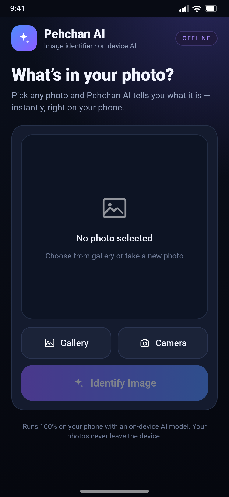
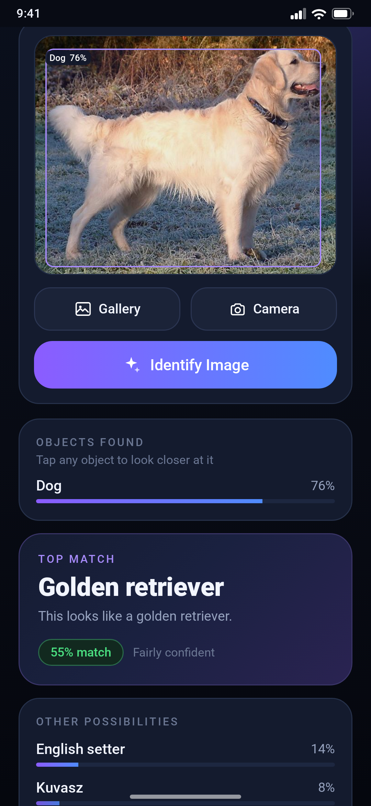
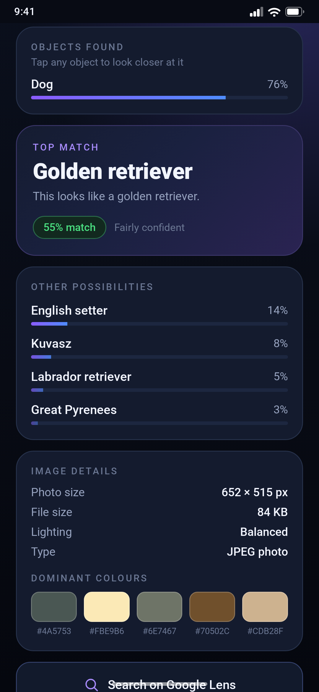
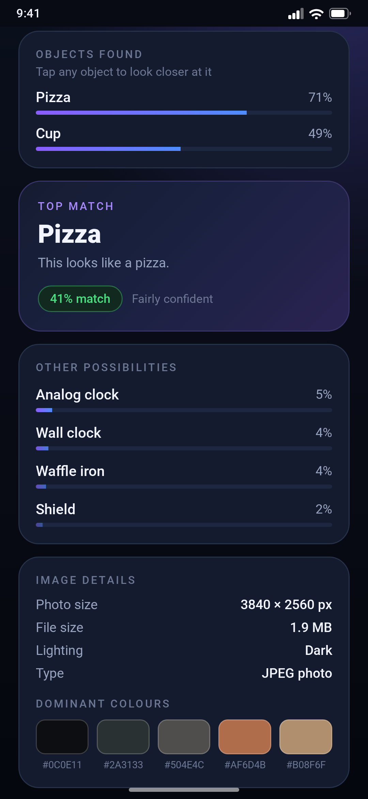

# Pehchan AI — Offline Image Identifier for Android

Point your phone at anything — a dog, a plate of food, a phone, a laptop, a chair — and
Pehchan AI finds every object in the photo, boxes it, and tells you what it is.
**Two AI models run entirely on the device**: no internet, no account, no upload, no ads.

| Home | Objects found | Result | Another example |
|:--:|:--:|:--:|:--:|
|  |  |  |  |

> These are UI previews rendered from the app's own layout (same dp values, colours and
> fonts) at 1080×2340 px, because the build machine had no Android emulator. The numbers in
> them are real — both models were run on those two photos to produce them.

---

## Download & install

**[⬇ Download PehchanAI-v1.6.apk (14 MB)](https://github.com/technicalnihilist-lgtm/pehchan-ai/releases/download/v1.6/PehchanAI-v1.6.apk)**

1. Tap the link on your phone (or open the [v1.6 release](https://github.com/technicalnihilist-lgtm/pehchan-ai/releases/tag/v1.6)).
2. Android asks to allow installs from this source → allow.
3. Install, open, done. **Android 5.0 (API 21) and newer**, any phone.

```
SHA-256  01cf5fbf298b3f0dcfb68aaf3765e739920c9718e6169346a815f66401037c48
```

Signed with v1 + v2 + v3 schemes, so it installs cleanly on modern Android.
Version 1.6 installs *over* v1.0–v1.5 (same signing key).

## What it does

* **Finds every object** — an on-device detector draws a box around each thing it sees and
  lists them with confidence: people, dogs, cats, birds, food, phones, laptops, TVs, chairs,
  tables, cars, bicycles, bottles, cups, and 60+ more categories.
* **Tap any object to look closer** — the app crops just that part of the photo and runs the
  fine-detail model on it, so "dog" becomes "golden retriever" and "car" becomes "sports car".
* **Plain-language answer** — "This looks like a golden retriever." + `55% match` + a
  confidence word (High / Fairly confident / Best guess), so the number means something.
* **Image details** — real photo size, file size, lighting (Bright / Balanced / Dark) and the
  five **dominant colours** with hex codes.
* **Search on Google Lens** — one tap for anything the on-device models don't know
  (brands, monuments, rare plants, specific products).
* **Wikipedia** — opens the article for the top match.
* **Share** — sends the photo plus the result text to any app.
* **Open-with support** — share an image *to* Pehchan AI from your gallery or any other app.

## Why it feels fast and safe

| | |
|---|---|
| **100% offline** | The app declares **no internet permission at all** — it physically cannot upload your photos. |
| **No permissions** | No storage, camera or location permission. Photos come through Android's own file picker; the camera hands back one photo. |
| **~14 MB** | Both models and the runtime are bundled; nothing is downloaded later. |
| **Works on any phone** | Native libraries for `arm64-v8a`, `armeabi-v7a`, `x86` and `x86_64`. |

## How it works

```
photo ──► decode (max 1600 px) ──► EXIF rotation fix
      ├─► 300×300  SSD-MobileNet detector ──► up to 10 boxes + labels  ──► drawn on the photo
      └─► 224×224  EfficientNet-Lite0      ──► 1000 ImageNet scores    ──► "best match"
                                          tap an object ──► crop ──► classify the crop
```

* **Detector** — SSD MobileNet V1, fully quantised, 300×300 uint8, COCO 80 classes, with
  non-max suppression built into the graph (`app/assets/detect.tflite`, 4.0 MB).
* **Classifier** — EfficientNet-Lite0 int8, 224×224 uint8, ImageNet-1k head
  (`app/assets/model.tflite`, 5.2 MB) — used for the whole photo *and* for the crop you tap.
* **Boxes** — drawn by `OverlayView`, which repeats the preview's centre-crop transform so the
  boxes stay glued to the right pixels at any photo shape.
* **Colours / lighting** — computed on a 44 px thumbnail in `ImageInfo.java`.
* **No support library, no Kotlin, no Compose** — plain Android framework classes, so the APK
  stays small and starts instantly.

### Honest limits

The detector knows the **80 COCO categories** — person, bicycle, car, motorcycle, airplane,
bus, train, truck, boat, traffic light, fire hydrant, stop sign, parking meter, bench, bird,
cat, dog, horse, sheep, cow, elephant, bear, zebra, giraffe, backpack, umbrella, handbag, tie,
suitcase, frisbee, skis, snowboard, sports ball, kite, baseball bat, baseball glove, skateboard,
surfboard, tennis racket, bottle, wine glass, cup, fork, knife, spoon, bowl, banana, apple,
sandwich, orange, broccoli, carrot, hot dog, pizza, donut, cake, chair, couch, potted plant,
bed, dining table, toilet, tv, laptop, mouse, remote, keyboard, cell phone, microwave, oven,
toaster, sink, refrigerator, book, clock, vase, scissors, teddy bear, hair drier, toothbrush.

The classifier adds **1000 fine-grained ImageNet classes** on top (dog breeds, bird species,
instruments, tools, and so on). Anything outside both lists — a specific brand, a monument, a
rare plant, a person's name — will come back as a low-confidence near-miss, which is exactly
what the **Search on Google Lens** button is for. No on-device model recognises *every*
object in the world; this one recognises a lot of them, instantly and privately.

## Build it yourself

No Gradle — just the Android SDK build-tools, which keeps the build easy to reproduce:

```bash
# needs: JDK 17, Android SDK build-tools 34 + platform android-35
export SDK=/path/to/android-sdk
bash app/build.sh          # → out/PehchanAI-v1.6.apk
```

`build.sh` runs the whole pipeline and prints each step:

```
fetch models (if missing) → aapt2 compile → aapt2 link → javac → d8
                          → package (dex + .so + assets) → zipalign → apksigner
```

It generates `app/keystore.jks` on first run if one is not present. **Keep that file** — Android
only accepts updates signed with the same key.

### Why the models are not in the tree

`app/assets/model.tflite` (5.2 MB) and `app/assets/detect.tflite` (4.0 MB) are attached to the
[v1.6 release](https://github.com/technicalnihilist-lgtm/pehchan-ai/releases/tag/v1.6) instead of
being committed, because the GitHub API rejects binaries that large in a normal commit.
`build.sh` downloads whichever one is missing, so a clean clone still builds with one command.
Both label files *are* in the tree.

## Project layout

```
app/
├── AndroidManifest.xml              no permissions, portrait, share/VIEW filters
├── build.sh                         the whole build, 8 steps
├── assets/
│   ├── detect.tflite                SSD-MobileNet detector, COCO 80 (fetched from the release)
│   ├── coco_labels.txt              the 80 object names
│   ├── model.tflite                 EfficientNet-Lite0 int8 (fetched from the release)
│   └── labels.txt                   1000 ImageNet labels
├── res/
│   ├── layout/activity_main.xml     single screen, one scroll
│   ├── drawable/                    gradients, cards, 9 hand-written vector icons
│   ├── values/                      colours, strings, theme
│   └── mipmap-*/                    launcher icon (adaptive + PNG fallbacks)
└── src/com/rajok/pehchanai/
    ├── MainActivity.java            UI, picking, camera, results, sharing
    ├── Detector.java                object detector + boxes
    ├── OverlayView.java             draws the boxes on the photo
    ├── Classifier.java              fine-detail classifier (whole photo + tapped crop)
    ├── ImageInfo.java               size / lighting / dominant colours
    └── FileShareProvider.java       tiny ContentProvider for camera + share
screenshots/                         UI previews (1080×2340)
```

## Changelog

**v1.6** — liquid-glass look. Every surface is now a translucent pane: cards and buttons use
a white 4–15% gradient fill with a 1 dp hairline border, the top-match card carries a violet
tint, pills and progress tracks are see-through, and the background has three soft colour
glows (violet, blue, teal) so the glass has something to show through. Pure drawables — no
blur dependency, so it looks the same on Android 5 through 15.

**v1.5** — smaller chrome, more photo: Gallery and Camera are 42 dp tall and Identify 46 dp
(13 sp / 15 sp text) instead of 50/56 dp, and the boxes drawn on the photo are lighter —
1.5 dp outline, much fainter fill, smaller label chips — so the image itself stays readable.

**v1.4** — slimmer UI: the confidence bars in OBJECTS FOUND and OTHER POSSIBILITIES are
4 dp instead of 7 dp with tighter row spacing, so the lists read as data instead of blocks,
and the object labels drawn on the photo are a little smaller so they cover less of the
image.

**v1.3** — fixes "Could not analyse this photo" on v1.1/v1.2. The detector's output buffer
for the detection-count tensor was allocated as `float[1][1]` while the tensor's shape is
`[1]`, so TensorFlow Lite threw a shape-mismatch error and took the whole analysis down with
it. Output buffers are now allocated from the shapes the interpreter reports. Also: the two
models fail independently (a detector problem can no longer hide the classifier result),
overlapping duplicate boxes are collapsed (a plate of food no longer lists "pizza" four
times), the object list shows one row per object type, and a long-press on the app name
shows the device details and the last error so problems can be reported exactly.

**v1.2** — the preview now shows the **whole photo**, never a cropped version: the image
fits inside the frame (`fitCenter`) and the frame takes the photo's own aspect ratio
(clamped between 180 and 470 dp), so a portrait shot is tall, a landscape shot is wide, and
nothing is cut off. Detection boxes follow the same fit-inside transform.

**v1.1** — object detection: every object in the photo is boxed and listed; tap an object to
classify just that part. New `OBJECTS FOUND` card, box overlay, richer share text.

**v1.0** — first release: single-model image identifier, image details, Lens/Wikipedia/Share.

## Credits

* Detector: SSD MobileNet V1 COCO (TensorFlow, Apache-2.0).
* Classifier: [EfficientNet-Lite0](https://github.com/tensorflow/tpu/tree/master/models/official/efficientnet/lite),
  converted and quantised by the TensorFlow team.
* Runtime: [TensorFlow Lite](https://www.tensorflow.org/lite) 2.14.0 (Apache-2.0).
* Labels: ImageNet class names, COCO category names.
* Everything else — UI, code, icons — written for this project.

## License

MIT — see [LICENSE](LICENSE).
